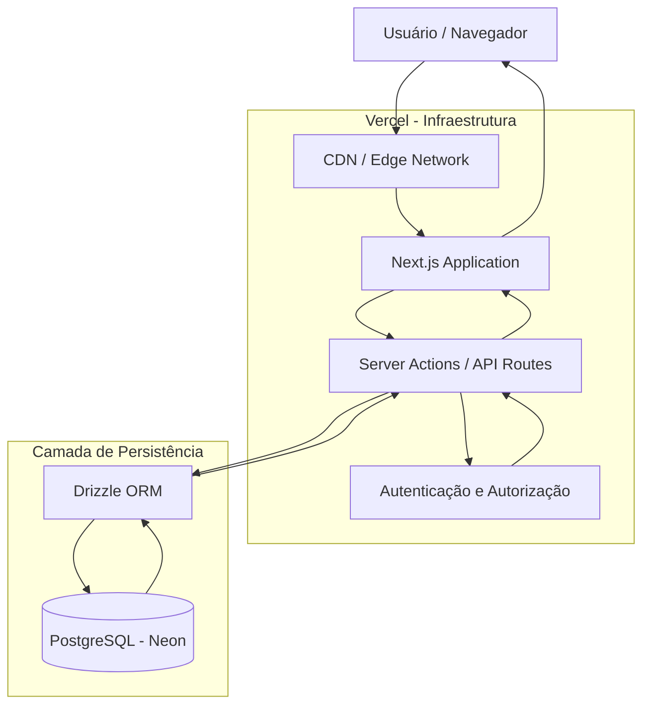
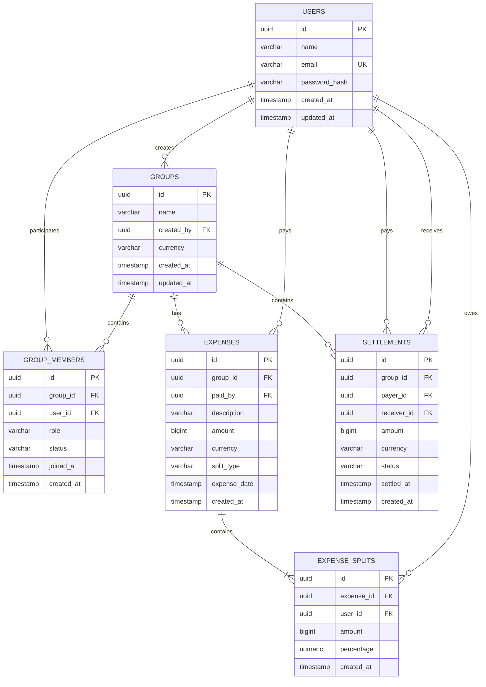
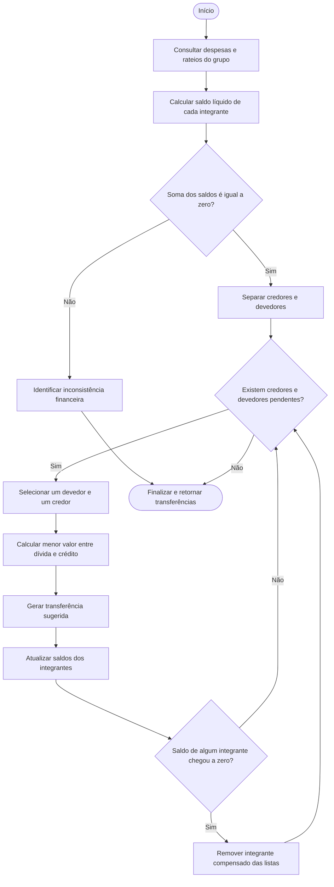

# Split-Go

Plataforma de divisão de despesas entre pessoas e grupos. O projeto permite criar grupos, convidar integrantes, registrar despesas com diferentes métodos de rateio, calcular saldos, gerar um plano simplificado de pagamentos e registrar/confirmar quitações.

## Stack

- Next.js 16 (App Router)
- React 19
- TypeScript
- PostgreSQL 17
- Drizzle ORM
- Tailwind CSS
- Zod
- Vitest
- Playwright

A interface usa apenas componentes próprios com Tailwind CSS.

## Arquitetura resumida

```text
src/
  app/                  Rotas e layouts do App Router
  components/           Componentes de UI, layout e feedback
  config/               Configuração de rotas, navegação e site
  db/                   Conexão, schema e tipos do Drizzle
  features/
    auth/               Cadastro, login, logout e sessões
    groups/             Grupos, integrantes e convites
    invitations/        Convites recebidos
    expenses/           Despesas, rateios e cálculos
    balances/           Saldos e plano simplificado
    settlements/        Pagamentos, confirmação, extrato e painel
    settings/           Perfil do usuário
  lib/                  Dinheiro, datas, validações, segurança e finanças
  test-utils/           Utilitários de banco de testes
drizzle/migrations/     Migrations versionadas
e2e/                    Testes end-to-end com Playwright
scripts/                Seed, preparação do banco e utilitários
```

### Regras financeiras principais

- Valores monetários são persistidos em centavos com `bigint`/`BIGINT`.
- A soma dos rateios de uma despesa deve ser exatamente igual ao total.
- A soma dos saldos do grupo deve ser zero.
- Apenas pagamentos `CONFIRMED` alteram os saldos.
- Pagamentos `PENDING` reservam disponibilidade, mas não quitam dívidas.
- O plano de pagamentos é apenas uma sugestão; ele não cria quitações automaticamente.
- Operações financeiras críticas usam transações e locks por grupo.
- Pagamentos confirmados não podem ser editados ou cancelados nesta etapa.

## Requisitos

- Node.js 20.9 ou superior (recomendado: Node.js 22)
- npm 10 ou superior
- PostgreSQL 17
- Docker e Docker Compose (opcional, para o banco local)

## Instalação local

1. Clone o repositório e acesse a pasta:

```bash
git clone https://github.com/cesarhenriq/Split-Go.git
cd Split-Go
```

2. Instale as dependências com o lockfile:

```bash
npm ci
```

3. Crie o arquivo `.env` a partir do exemplo:

```bash
cp .env.example .env
```

No Windows PowerShell:

```powershell
Copy-Item .env.example .env
```

4. Suba o PostgreSQL local:

```bash
docker compose up -d
```

5. Aplique as migrations:

```bash
npm run db:migrate
```

6. Opcionalmente, crie usuários de demonstração:

```bash
npm run db:seed
```

Usuários criados de forma idempotente:

```text
ana@splitgo.dev
bruno@splitgo.dev
carla@splitgo.dev
diego@splitgo.dev
```

A senha padrão de desenvolvimento é `senha-segura-123`. Defina `SEED_USER_PASSWORD` para usar outra senha. O script não altera usuários existentes e recusa execução em produção sem uma senha configurada.

7. Inicie a aplicação:

```bash
npm run dev
```

Acesse `http://localhost:3000`.

## Variáveis de ambiente

Use `.env.example` como referência. Nunca versione o `.env` real.

| Variável               | Obrigatória     | Descrição                                              |
| ---------------------- | --------------- | ------------------------------------------------------ |
| `DATABASE_URL`         | Sim             | Conexão de runtime. Em produção, use a URL com pooler. |
| `DIRECT_URL`           | Para migrations | Conexão direta usada pelo Drizzle Kit.                 |
| `NEXT_PUBLIC_APP_URL`  | Em produção     | URL pública da aplicação.                              |
| `DB_POSTGRES_USER`     | Docker local    | Usuário do PostgreSQL local.                           |
| `DB_POSTGRES_PASSWORD` | Docker local    | Senha do PostgreSQL local.                             |
| `DB_POSTGRES_DB`       | Docker local    | Nome do banco local.                                   |
| `DB_POOL_MAX`          | Não             | Máximo de conexões por instância. Padrão: `5`.         |
| `SEED_USER_PASSWORD`   | Não             | Senha dos usuários criados pelo seed.                  |
| `RATE_LIMIT_*`         | Não             | Overrides dos limites de login, cadastro e convites.   |

Não existe segredo separado de autenticação: as sessões usam tokens aleatórios, armazenados apenas como hash SHA-256 no banco.

## Banco de dados

### Desenvolvimento

```bash
npm run db:migrate
```

### Testes de integração

O script abaixo recria o banco de teste e aplica todas as migrations. Ele **apaga o schema** do banco de teste; nunca aponte `TEST_DATABASE_URL` para produção.

```bash
npm run db:test:prepare
```

O banco de teste padrão é `splitgo_test`, derivado de `DATABASE_URL`. Também é possível definir `TEST_DATABASE_URL`; o nome precisa terminar em `_test`.

### Migrations

- As migrations ficam em `drizzle/migrations` e são versionadas.
- Use `npm run db:generate` para gerar uma nova migration.
- Use `npm run db:migrate` para aplicar migrations.
- Use `npm run db:check` para validar o histórico.
- **Não use `drizzle-kit push` em produção.**

## Testes

### Unitários

```bash
npm run test:unit
```

Cobrem validações, dinheiro, rateios, simplificação de dívidas, cálculo de saldos e formatação de datas.

### Integração

Requer PostgreSQL local ou um banco de teste acessível.

```bash
npm run test:integration
```

Cobrem autenticação, sessões, grupos, convites, despesas, saldos, pagamentos, extrato, permissões, concorrência e rate limiting.

### End-to-end

Instale o navegador Chromium uma vez:

```bash
npm run test:e2e:install
```

Depois execute:

```bash
npm run test:e2e
```

O Playwright sobe um servidor de desenvolvimento em `http://127.0.0.1:3100`, usando o banco de teste. Ele usa `next dev` porque o cookie de sessão é `Secure` em produção e os testes locais rodam em HTTP.

Cenários cobertos:

1. Cadastro, login, logout e proteção de rotas.
2. Criação de grupo, convite e aceite.
3. Despesas e rateios.
4. Simplificação de dívidas e plano de pagamentos.
5. Registro de pagamento, confirmação, histórico e extrato.

### Qualidade

```bash
npm run lint
npm run typecheck
npm run build
npm audit --omit=dev
```

## CI/CD

O workflow `.github/workflows/ci.yml` executa em Pull Requests e pushes para `develop`/`main`:

- lint;
- typecheck;
- testes unitários;
- testes de integração com PostgreSQL 17;
- build de produção;
- testes E2E com Playwright.

Nenhuma credencial real é usada no CI. O PostgreSQL é um service container local do runner.

A Vercel deve continuar usando a integração nativa com o GitHub. O workflow não faz deploy automático.

## Deploy na Vercel

### 1. Banco PostgreSQL

Recomenda-se Neon:

1. Crie um projeto no Neon.
2. Use a connection string **pooled** como `DATABASE_URL` de runtime.
3. Use a connection string **direct** como `DIRECT_URL` para migrations.
4. Mantenha `sslmode=require` na URL.

### 2. Projeto na Vercel

1. Importe o repositório na Vercel.
2. Framework: Next.js.
3. Build command: `npm run build`.
4. Install command: `npm ci`.
5. Configure as variáveis:
   - `DATABASE_URL` (pooled);
   - `DIRECT_URL` (direct);
   - `NEXT_PUBLIC_APP_URL` com a URL pública de produção;
   - `DB_POOL_MAX` opcional.
6. Não configure `SEED_USER_PASSWORD` em produção sem necessidade.

### 3. Migrations de produção

As migrations **não** rodam automaticamente no build ou no start da aplicação. Execute uma única vez, em um ambiente confiável ou job de CI:

```bash
DIRECT_URL="postgresql://..." DATABASE_URL="postgresql://..." npm run db:migrate
```

Antes:

```bash
npm run db:check
```

Evite executar migrations em múltiplas instâncias ao mesmo tempo.

### 4. Primeiro deploy

Após configurar as variáveis e aplicar as migrations:

1. Faça o deploy pela Vercel.
2. Acesse a URL pública.
3. Valide cadastro/login.
4. Crie um grupo e uma despesa.
5. Registre e confirme um pagamento.
6. Verifique o painel financeiro, o histórico e o extrato.

## Segurança

- Senhas com Argon2id.
- Tokens de sessão aleatórios armazenados como hash.
- Cookie `HttpOnly`, `Secure` em produção e `SameSite=Lax`.
- Autorização verificada no backend por grupo e por recurso.
- Validação de entrada com Zod nas Server Actions.
- Consultas parametrizadas via Drizzle.
- Rate limiting persistido no PostgreSQL para login, cadastro e convites.
- Headers de segurança básicos configurados no Next.js.
- Nenhum segredo versionado.

### Limitações conhecidas

- Não há envio de e-mail nem verificação de e-mail; convites são exibidos dentro da aplicação.
- Não há recuperação de senha.
- Pagamentos confirmados são imutáveis; não há estorno implementado.
- A CSP completa não está configurada porque os scripts inline do Next exigiriam nonce/proxy.
- As páginas globais `/expenses` e `/settlements` são apenas informativas; o fluxo completo está nas rotas de cada grupo.

## Comandos

```bash
npm run dev             # desenvolvimento
npm run build           # build de produção
npm run start           # servidor de produção
npm run lint            # lint e formatação
npm run typecheck       # TypeScript
npm run test            # testes unitários em watch
npm run test:unit       # testes unitários
npm run test:integration # testes de integração
npm run test:e2e        # testes end-to-end
npm run test:e2e:install # instala o Chromium do Playwright
npm run db:generate     # gera migration
npm run db:migrate      # aplica migrations
npm run db:seed         # cria usuários de demonstração
npm run db:check        # valida histórico de migrations
npm run db:studio       # Drizzle Studio
```

# Arquitetura e Modelagem do Sistema

## 1. Arquitetura da Aplicação

### 1.1 Visão geral

A aplicação utiliza uma arquitetura Full Stack baseada em Next.js, concentrando a interface e as operações de backend em um único projeto.

A infraestrutura é composta por:

- **Next.js:** framework responsável pela interface, renderização e camada de backend.
- **Vercel:** plataforma de hospedagem, deploy contínuo e execução da aplicação.
- **Drizzle ORM:** camada de acesso ao banco de dados, oferecendo consultas tipadas e gerenciamento de migrations.
- **PostgreSQL (Neon):** banco de dados relacional responsável pela persistência e integridade das informações.

### 1.2 Diagrama de arquitetura



### 1.3 Fluxo de comunicação

1. O usuário acessa a aplicação pelo navegador.
2. A Vercel recebe a requisição e direciona para a aplicação Next.js.
3. O Next.js processa a requisição e executa as operações necessárias no servidor.
4. A camada de autenticação verifica a identidade e as permissões do usuário.
5. O Drizzle ORM executa as consultas no PostgreSQL.
6. O banco de dados retorna os resultados.
7. O Next.js processa os dados e devolve a resposta ao usuário.

### 1.4 Decisões arquiteturais

| Tecnologia  | Responsabilidade   | Justificativa                                                       |
| ----------- | ------------------ | ------------------------------------------------------------------- |
| Next.js     | Frontend e Backend | Centralização da aplicação e redução da complexidade operacional.   |
| Vercel      | Hosting            | Integração nativa com Next.js e deploy automatizado.                |
| Drizzle ORM | Persistência       | Tipagem forte, consultas SQL-first e migrations.                    |
| PostgreSQL  | Banco de dados     | Integridade referencial, transações ACID e consistência financeira. |
| Neon        | Banco gerenciado   | PostgreSQL serverless com integração adequada à Vercel.             |

### 1.5 Estratégia de processamento

Na primeira versão, as operações financeiras são processadas de forma síncrona utilizando transações no PostgreSQL.

Não há necessidade de introduzir Redis ou filas para o funcionamento inicial do sistema.

Em uma evolução futura, serviços de processamento assíncrono poderão ser utilizados para notificações, envio de convites, relatórios e outras tarefas que não precisam bloquear as operações principais.

---

## 2. Modelagem Entidade-Relacionamento (ER)

### 2.1 Visão geral

A modelagem relacional foi estruturada para representar usuários, grupos, integrantes, despesas, rateios e liquidações.

O objetivo é garantir integridade referencial, rastreabilidade das operações financeiras e flexibilidade para futuras evoluções.

### 2.2 Diagrama ER



### 2.3 Descrição das entidades

**Users**

Armazena os usuários cadastrados na plataforma.

Responsabilidades:
- Identificação dos usuários.
- Autenticação.
- Relacionamento com grupos e despesas.

**Groups**

Representa os grupos de compartilhamento de despesas.

Responsabilidades:
- Identificação do grupo.
- Definição do criador.
- Definição da moeda padrão.
- Organização dos integrantes e despesas.

**GroupMembers**

Tabela associativa responsável pelo relacionamento entre usuários e grupos.

Responsabilidades:
- Identificar os integrantes de cada grupo.
- Controlar permissões e papéis.
- Gerenciar o status de participação e convites.

O status pode representar situações como pendente, aceito, recusado ou inativo.

**Expenses**

Armazena as despesas registradas nos grupos.

Responsabilidades:
- Identificação da despesa.
- Usuário responsável pelo pagamento.
- Valor total.
- Moeda utilizada.
- Tipo de rateio.
- Data da despesa.

**ExpenseSplits**

Representa a distribuição financeira de cada despesa entre os integrantes.

Responsabilidades:
- Identificar os participantes do rateio.
- Registrar quanto cada integrante deve.
- Armazenar o percentual quando aplicável.
- Garantir que a soma das parcelas corresponda ao valor total da despesa.

**Settlements**

Armazena as liquidações financeiras entre integrantes.

Responsabilidades:
- Identificar quem paga.
- Identificar quem recebe.
- Registrar o valor da transferência.
- Controlar o status da liquidação.
- Preservar o histórico de pagamentos.

### 2.4 Regras de integridade

- Um usuário pode participar de vários grupos.
- Um grupo pode possuir vários integrantes.
- Um grupo pode possuir várias despesas.
- Uma despesa deve possuir pelo menos um rateio.
- Cada rateio pertence a uma despesa e a um integrante.
- Uma liquidação pertence a um grupo e identifica um pagador e um recebedor.
- Os valores monetários são armazenados em centavos utilizando inteiros.
- A moeda deve ser identificada explicitamente por seu código ISO 4217.
- A exclusão de registros financeiros deve preservar o histórico e respeitar as dependências relacionais.

### 2.5 Restrições e índices recomendados

| Tabela        | Restrição ou índice                |
| ------------- | ---------------------------------- |
| Users         | Email único.                       |
| Groups        | Índice em created_by.              |
| GroupMembers  | UNIQUE(group_id, user_id).         |
| Expenses      | Índice em group_id e expense_date. |
| ExpenseSplits | Índice em expense_id e user_id.    |
| Settlements   | Índice em group_id e status.       |

Também devem ser utilizadas chaves estrangeiras e restrições CHECK para proteger a integridade dos dados.

---

## 3. Fluxo de Simplificação de Dívidas

### 3.1 Objetivo

O algoritmo de simplificação de dívidas tem como objetivo reduzir a quantidade de transferências necessárias entre os integrantes de um grupo, sem alterar os valores financeiros devidos por cada participante.

Em vez de gerar uma transferência para cada despesa individual, o sistema calcula o saldo líquido de cada integrante e realiza compensações entre credores e devedores.

### 3.2 Etapa 1 — Cálculo dos saldos

Para cada integrante, o sistema calcula:

**Saldo líquido = Total pago - Total devido**

Onde:

- Saldo positivo: o integrante tem valores a receber.
- Saldo negativo: o integrante possui valores a pagar.
- Saldo zero: o integrante não possui pendências.

Exemplo:

| Integrante |    Total pago |  Total devido |       Saldo |
| ---------- | ------------: | ------------: | ----------: |
| A          |     R$ 150,00 |      R$ 50,00 | + R$ 100,00 |
| B          |     R$ 100,00 |      R$ 50,00 |  + R$ 50,00 |
| C          |       R$ 0,00 |      R$ 80,00 |  - R$ 80,00 |
| D          |       R$ 0,00 |      R$ 70,00 |  - R$ 70,00 |
| **Total**  | **R$ 250,00** | **R$ 250,00** | **R$ 0,00** |

A soma dos saldos deve ser sempre igual a zero.

### 3.3 Etapa 2 — Separação entre credores e devedores

Após o cálculo dos saldos, os integrantes são separados em dois grupos:

- **Credores:** possuem saldo positivo e precisam receber.
- **Devedores:** possuem saldo negativo e precisam pagar.

O algoritmo trabalha com os valores absolutos dos saldos, mantendo os valores originais armazenados em centavos.

### 3.4 Etapa 3 — Algoritmo de compensação

O algoritmo utiliza uma estratégia gulosa (Greedy Algorithm), realizando compensações entre os devedores e credores.

A cada iteração:

1. Seleciona um devedor com saldo pendente.
2. Seleciona um credor com saldo a receber.
3. Calcula o menor valor entre a dívida e o crédito.
4. Gera uma transferência com esse valor.
5. Atualiza os saldos de ambos os integrantes.
6. Remove os integrantes cujos saldos foram totalmente compensados.
7. Repete até que não existam mais valores pendentes.

O valor de cada transferência é:

`transferência = min(dívida, crédito)`

### 3.5 Diagrama do fluxo de simplificação



### 3.6 Exemplo prático de simplificação

Considerando os saldos calculados anteriormente:

| Integrante |       Saldo |
| ---------- | ----------: |
| A          | + R$ 100,00 |
| B          |  + R$ 50,00 |
| C          |  - R$ 80,00 |
| D          |  - R$ 70,00 |

O algoritmo gera as seguintes transferências:

| Devedor | Credor |    Valor |
| ------- | ------ | -------: |
| C       | A      | R$ 80,00 |
| D       | A      | R$ 20,00 |
| D       | B      | R$ 50,00 |

Resultado:

- Integrante C quita sua dívida de R$ 80,00.
- Integrante D quita sua dívida de R$ 70,00.
- Integrante A recebe R$ 100,00.
- Integrante B recebe R$ 50,00.

Todas as obrigações são compensadas utilizando apenas três transferências.

### 3.7 Pseudocódigo do algoritmo

```typescript
type Balance = {
  userId: string;
  amount: number; // Centavos
};

type Transfer = {
  payerId: string;
  receiverId: string;
  amount: number; // Centavos
};

function simplifyDebts(balances: Balance[]): Transfer[] {
  const creditors = balances
    .filter((item) => item.amount > 0)
    .map((item) => ({ ...item }));

  const debtors = balances
    .filter((item) => item.amount < 0)
    .map((item) => ({
      userId: item.userId,
      amount: Math.abs(item.amount),
    }));

  const totalCredit = creditors.reduce(
    (sum, item) => sum + item.amount,
    0
  );

  const totalDebt = debtors.reduce(
    (sum, item) => sum + item.amount,
    0
  );

  if (totalCredit !== totalDebt) {
    throw new Error("Inconsistência nos saldos financeiros.");
  }

  const transfers: Transfer[] = [];

  let debtorIndex = 0;
  let creditorIndex = 0;

  while (
    debtorIndex < debtors.length &&
    creditorIndex < creditors.length
  ) {
    const debtor = debtors[debtorIndex];
    const creditor = creditors[creditorIndex];

    const amount = Math.min(
      debtor.amount,
      creditor.amount
    );

    transfers.push({
      payerId: debtor.userId,
      receiverId: creditor.userId,
      amount,
    });

    debtor.amount -= amount;
    creditor.amount -= amount;

    if (debtor.amount === 0) {
      debtorIndex++;
    }

    if (creditor.amount === 0) {
      creditorIndex++;
    }
  }

  return transfers;
}
```

### 3.8 Garantias de integridade

Para garantir a confiabilidade do algoritmo:

- Todos os cálculos devem utilizar valores inteiros em centavos.
- A soma dos saldos dos integrantes deve ser igual a zero antes da execução.
- A soma das transferências deve corresponder ao total de créditos e débitos compensados.
- Nenhuma transferência pode possuir valor igual ou inferior a zero.
- Um integrante não deve pagar a si mesmo.
- Os valores originais das despesas e dos rateios não devem ser modificados pelo algoritmo.
- As transferências geradas devem ser tratadas como sugestões de quitação até que sejam efetivamente confirmadas.
- Todas as operações de persistência devem respeitar as transações e regras de concorrência do PostgreSQL.

### 3.9 Complexidade do algoritmo

Considerando N integrantes:

- Cálculo dos saldos: O(E + S), onde E representa as despesas e S representa os rateios.
- Separação entre credores e devedores: O(N).
- Compensação dos saldos: O(N), utilizando listas ordenadas de credores e devedores.
- Complexidade total da simplificação, desconsiderando a consulta inicial: O(N).

O algoritmo guloso não garante necessariamente a quantidade global mínima de transferências para todas as distribuições possíveis de saldos, mas oferece uma solução eficiente e simples para reduzir significativamente a quantidade de operações.

---

## Considerações finais

A arquitetura proposta prioriza simplicidade operacional, escalabilidade e consistência financeira.

A modelagem relacional garante a integridade dos relacionamentos entre usuários, grupos e operações financeiras.

O algoritmo de simplificação permite reduzir a quantidade de transferências necessárias para quitar as despesas compartilhadas, preservando os saldos individuais e a rastreabilidade das operações.

Essas decisões estabelecem uma base técnica adequada para a primeira versão e permitem evoluções futuras sem exigir mudanças fundamentais na arquitetura.

##  Proposta de Evolução do Produto (V2)

A evolução da plataforma tem como objetivo ampliar as possibilidades de utilização, melhorar a experiência dos usuários e agregar novas oportunidades de negócio.

As funcionalidades propostas para a versão 2 priorizam automação financeira, flexibilidade e inteligência na gestão das despesas compartilhadas.

### V2.1 — Integração com pagamentos via Pix

**Objetivo:** permitir que os integrantes realizem pagamentos diretamente pelo aplicativo, facilitando a quitação das despesas compartilhadas.

**Funcionalidades propostas:**
- Integração com provedores de pagamento que ofereçam suporte ao Pix.
- Geração de QR Codes e códigos Pix Copia e Cola.
- Identificação automática de pagamentos por meio de webhooks.
- Atualização automática do status das pendências após confirmação do pagamento.
- Histórico de transações realizadas.

**Impacto no negócio:**

Reduz a fricção no processo de quitação das dívidas, melhora a experiência dos usuários e cria oportunidades de monetização por meio de parcerias com instituições financeiras e provedores de pagamento.

### V2.2 — Suporte a múltiplas moedas

**Objetivo:** permitir que grupos registrem despesas em diferentes moedas, atendendo usuários que compartilham despesas durante viagens ou possuem relações financeiras internacionais.

**Funcionalidades propostas:**
- Suporte a diferentes moedas, inicialmente BRL, USD e EUR.
- Definição de uma moeda de referência para cada grupo.
- Conversão automática de valores utilizando serviços de cotação cambial.
- Armazenamento da taxa de câmbio aplicada no momento do registro da despesa.
- Histórico de conversões para preservar a consistência dos valores originais.
- Exibição dos valores originais e convertidos.

**Impacto no negócio:**

Amplia o público potencial da plataforma, permitindo atender grupos de viagem, famílias e usuários que compartilham despesas em diferentes países.

### V2.3 — Relatórios e inteligência financeira

**Objetivo:** oferecer informações detalhadas sobre os hábitos de consumo e a distribuição das despesas dentro dos grupos.

**Funcionalidades propostas:**
- Dashboard com gráficos de despesas por período.
- Agrupamento de despesas por categorias.
- Comparativo de gastos entre integrantes.
- Histórico de despesas e liquidações.
- Exportação de relatórios em PDF e CSV.
- Indicadores de despesas pendentes e valores já quitados.

**Impacto no negócio:**

Aumenta o engajamento e a retenção dos usuários, agregando valor à plataforma e criando possibilidades futuras de planos premium com recursos avançados de análise financeira.

---

## Análise de Edge Cases — Rateio e Moedas

Operações financeiras exigem atenção especial à precisão dos valores, integridade dos dados e consistência dos cálculos.

A aplicação considera os seguintes cenários de borda para garantir que as despesas e os rateios sejam processados corretamente.

### 1. Divisão de valores com arredondamento

**Cenário:**

Uma despesa de R$ 100,00 precisa ser dividida igualmente entre três integrantes.

A divisão matemática resulta em:

`10000 / 3 = 3333,333... centavos`

Como não existem frações de centavos na representação monetária brasileira, é necessário distribuir o restante.

**Risco:**

A utilização de números decimais de ponto flutuante pode gerar imprecisões e fazer com que a soma das parcelas seja diferente do valor original.

**Tratamento:**

- Armazenar valores monetários como inteiros, representando centavos.
- Utilizar operações inteiras para os cálculos financeiros.
- Distribuir os centavos restantes de maneira determinística, seguindo uma ordem estável dos participantes.
- Garantir que a soma das parcelas corresponda exatamente ao valor original.

**Resultado esperado:**

| Integrante   |         Valor |
| ------------ | ------------: |
| Integrante A |      R$ 33,34 |
| Integrante B |      R$ 33,33 |
| Integrante C |      R$ 33,33 |
| **Total**    | **R$ 100,00** |

**Regra de integridade:**

`SUM(parcelas) = valor_total_da_despesa`

### 2. Valores negativos ou iguais a zero

**Cenário:**

Um usuário tenta cadastrar uma despesa com valor igual a zero ou negativo.

**Risco:**

Valores inválidos podem comprometer o cálculo dos saldos e produzir resultados financeiros inconsistentes.

**Tratamento:**

- Rejeitar despesas com valores menores ou iguais a zero.
- Validar os dados no frontend e no backend.
- Utilizar Zod para validação dos dados recebidos.
- Aplicar restrições no banco de dados para impedir valores inválidos.
- Validar também se o valor recebido está dentro dos limites suportados pelo sistema.

**Regra de integridade:**

`expense.amount > 0`

### 3. Rateio percentual com soma diferente de 100%

**Cenário:**

Uma despesa de R$ 200,00 é dividida entre três integrantes utilizando os seguintes percentuais:

| Integrante   | Percentual |
| ------------ | ---------: |
| Integrante A |        50% |
| Integrante B |        30% |
| Integrante C |        15% |
| **Total**    |    **95%** |

**Risco:**

A soma dos valores distribuídos será inferior ao valor original da despesa, deixando uma diferença financeira sem responsável.

**Tratamento:**

- Validar se a soma dos percentuais corresponde exatamente a 100%.
- Rejeitar percentuais negativos ou superiores a 100%.
- Realizar os cálculos utilizando aritmética inteira ou decimal de precisão controlada.
- Distribuir eventuais diferenças de arredondamento em centavos de forma determinística.
- Impedir a persistência de rateios inconsistentes.

**Regra de integridade:**

`SUM(percentuais) = 100%`

E:

`SUM(parcelas) = valor_total_da_despesa`

### 4. Remoção de integrante com despesas pendentes

**Cenário:**

Um integrante deseja sair de um grupo, mas ainda possui despesas pendentes de pagamento.

**Risco:**

A exclusão física do integrante pode comprometer o histórico financeiro, gerar referências inválidas e eliminar informações necessárias para a prestação de contas.

**Tratamento:**

- Não permitir a exclusão física de registros que possuam dependências financeiras.
- Preservar o histórico de despesas e rateios.
- Permitir a saída do integrante do grupo sem apagar seu histórico.
- Manter os valores pendentes associados ao integrante original.
- Utilizar exclusão lógica ou status de participação inativo, conforme a modelagem adotada.

**Regra de negócio:**

A saída de um grupo não deve eliminar obrigações financeiras já registradas.

### 5. Simplificação de dívidas com múltiplos credores e devedores

**Cenário:**

Um grupo possui várias despesas compartilhadas, resultando em diferentes valores a pagar e receber entre os integrantes.

Exemplo:

| Integrante   |       Saldo |
| ------------ | ----------: |
| Integrante A | + R$ 100,00 |
| Integrante B |  + R$ 50,00 |
| Integrante C |  - R$ 80,00 |
| Integrante D |  - R$ 70,00 |
| **Total**    | **R$ 0,00** |

**Risco:**

Uma implementação incorreta do algoritmo pode gerar transferências redundantes, valores inconsistentes ou até mesmo criar obrigações financeiras inexistentes.

**Tratamento:**

- Calcular o saldo líquido de cada integrante.
- Separar os integrantes entre credores (saldo positivo) e devedores (saldo negativo).
- Utilizar um algoritmo de casamento entre credores e devedores.
- Realizar as compensações até que todos os saldos sejam zerados.
- Trabalhar exclusivamente com valores inteiros em centavos.
- Validar que o total a pagar seja igual ao total a receber.

**Resultado esperado:**

| Devedor      | Credor       |    Valor |
| ------------ | ------------ | -------: |
| Integrante C | Integrante A | R$ 80,00 |
| Integrante D | Integrante A | R$ 20,00 |
| Integrante D | Integrante B | R$ 50,00 |

A simplificação reduz a quantidade de transferências necessárias sem alterar o resultado financeiro final.

**Regra de integridade:**

`SUM(saldos) = 0`

O algoritmo deve preservar o valor líquido devido por cada integrante.

### 6. Despesas registradas em moedas diferentes

**Cenário:**

Um integrante registra uma despesa em dólares americanos (USD), enquanto o grupo utiliza o real brasileiro (BRL) como moeda padrão.

**Risco:**

Somar diretamente valores de moedas diferentes produz resultados financeiros inválidos, pois cada moeda possui uma unidade e um valor de referência distintos.

**Tratamento no MVP:**

- Cada grupo possui uma moeda padrão.
- Todas as despesas devem utilizar a moeda definida pelo grupo.
- Rejeitar despesas registradas em moedas diferentes da moeda do grupo.
- Armazenar explicitamente o código ISO 4217 da moeda utilizada.
- Não realizar conversões cambiais implícitas.

**Evolução futura (V2):**

- Permitir despesas em múltiplas moedas.
- Utilizar serviços externos para consultar cotações cambiais.
- Registrar a taxa de conversão utilizada no momento da operação.
- Preservar o valor e a moeda originais da despesa.
- Utilizar a moeda de referência do grupo para calcular os saldos consolidados.

### 7. Liquidação duplicada ou operações concorrentes

**Cenário:**

Dois usuários tentam confirmar simultaneamente a mesma liquidação, ou o usuário realiza uma nova tentativa após uma falha de comunicação.

**Risco:**

A mesma obrigação financeira pode ser considerada quitada mais de uma vez, gerando inconsistências nos saldos do grupo.

**Tratamento:**

- Utilizar transações no PostgreSQL para garantir atomicidade.
- Validar o estado atual da liquidação antes de efetuar alterações.
- Implementar controle de concorrência por meio de bloqueios ou atualizações condicionais.
- Impedir a transição de uma liquidação já confirmada para o mesmo estado novamente.
- Utilizar identificadores idempotentes quando houver integração com serviços externos.

**Regra de integridade:**

Uma liquidação já confirmada não pode ser processada novamente como uma nova quitação.

---

## Estratégias gerais de integridade financeira

Além dos cenários apresentados, a aplicação adota as seguintes estratégias para preservar a consistência dos dados financeiros:

| Aspecto            | Estratégia                                                                  |
| ------------------ | --------------------------------------------------------------------------- |
| Precisão monetária | Valores armazenados em centavos utilizando inteiros.                        |
| Moedas             | Identificação explícita utilizando códigos ISO 4217.                        |
| Rateio             | Soma das parcelas igual ao valor original da despesa.                       |
| Percentuais        | Soma dos percentuais igual a 100%.                                          |
| Saldos             | Soma dos saldos líquidos do grupo igual a zero.                             |
| Transações         | Operações financeiras executadas com transações PostgreSQL.                 |
| Concorrência       | Bloqueios e atualizações condicionais quando necessários.                   |
| Validação          | Validação de dados no servidor e restrições no banco.                       |
| Histórico          | Preservação dos registros financeiros e das liquidações.                    |
| Segurança          | Verificação de autorização para todas as operações relacionadas aos grupos. |

## Considerações finais

A arquitetura e as regras de negócio foram pensadas para garantir que as operações financeiras sejam previsíveis, consistentes e auditáveis.

A utilização de valores inteiros em centavos, transações no PostgreSQL e validações no backend reduz significativamente os riscos de inconsistências durante o rateio e a liquidação de despesas.

As funcionalidades propostas para a V2 poderão ser incorporadas gradualmente, sem comprometer as regras fundamentais de integridade financeira estabelecidas na primeira versão.

